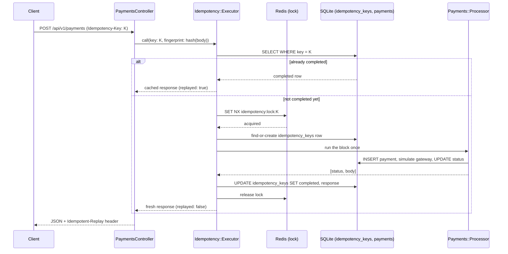

# Payment Service (Idempotency Demo)

A small Rails API that simulates a payment gateway, built to demonstrate one
thing well: **how to make a "charge the card" endpoint safe to retry**, using
the same `Idempotency-Key` pattern used by Stripe, PayPal, and most real
payment APIs.

It's a study/portfolio project, not a real payment processor — there's no
actual gateway integration, just a simulated one with realistic latency and
declines.

## The problem this solves

A client calls `POST /payments`. The request times out before the response
comes back. Did the charge go through? The client doesn't know, so it
retries. If the server just re-runs the same logic, the customer gets charged
twice.

The fix: the client generates a unique `Idempotency-Key` for the *logical*
operation ("charge this cart") and sends it on every retry of that same
operation. The server guarantees that no matter how many times a key is
replayed — sequentially or concurrently — the side effect (the charge) only
happens once, and every caller gets back the same response.

## Architecture



Two independent layers make duplicate charges impossible, on purpose:

| Layer | Mechanism | Purpose |
|---|---|---|
| **Correctness guarantee** | A unique index on `idempotency_keys.key` (and on `payments.idempotency_key_id`) | The database physically refuses a second insert for the same key. This holds even if Redis is down, the lock expires mid-request, or there's a bug in the lock logic. |
| **Performance / UX** | A Redis distributed lock (`Idempotency::Lock`) | Lets concurrent retries of the *same* key queue up and get the real answer back (with the correct HTTP status and body), instead of racing each other into a DB error. |

If you deleted the Redis lock entirely, the system would still never double-charge
a card — concurrent requests would just occasionally see a `409` instead of a
clean replay. The lock's only job is to turn "safe but ugly" into "safe and
correct-looking to every caller."

### Code layout

```
app/
  controllers/api/v1/payments_controller.rb   # HTTP layer: params, headers, error -> status mapping
  services/idempotency/
    lock.rb                 # Redis SET NX / Lua-script-release distributed lock
    request_fingerprint.rb  # hashes the request so key reuse with a different body is rejected
    executor.rb             # orchestrates: check cache -> lock -> run once -> store -> return
  services/payments/
    processor.rb            # the "gateway": fake latency, deterministic test-card declines
  models/
    idempotency_key.rb       # one row per key ever seen; unique index is the real safety net
    payment.rb
  jobs/
    settle_payment_job.rb   # Sidekiq job simulating an async settlement webhook
```

### The idempotency protocol, step by step

1. Client sends `POST /api/v1/payments` with header `Idempotency-Key: <uuid>`.
2. If a **completed** record for that key already exists, its stored
   response is replayed verbatim — the charge logic never runs again.
3. If the same key arrives with a **different request body**, the server
   returns `422 idempotency_key_reused_with_different_params` instead of
   silently doing the wrong thing. (This is what real APIs like Stripe do
   too — it's almost always a client bug.)
4. Otherwise, the server takes a short-lived Redis lock for that key so
   concurrent retries wait instead of racing, does the work exactly once,
   stores the response, and releases the lock.
5. The response always carries an `Idempotent-Replay: true|false` header so
   you can see which path was taken.

### A real bug this project found (and fixed)

While load-testing this with truly concurrent HTTP requests (not just
in-process threads), a small number of requests occasionally got a `422`
or `500` instead of a clean replay — even though **no duplicate payment was
ever created** (the DB unique index did its job). The cause: Rails caches
identical `SELECT`s within a single request. A request that read "key not
found yet," then blocked waiting for the lock, then re-read the same row
*after* another request had already finished, was served the first,
now-stale "not found" answer from the per-request query cache instead of a
fresh one — and tried to redo work that was already done.

The fix is one line: the whole `Idempotency::Executor#call` runs inside
`ActiveRecord::Base.uncached { ... }`. There's a regression test for this
exact scenario in `spec/services/idempotency/executor_spec.rb` ("is not
fooled by a stale per-request query cache"), plus a 12-thread concurrency
test proving the charge block runs exactly once no matter how many
identical requests race in.

### Known limitation / extension point

If a process crashes *after* creating the `idempotency_keys` row but
*before* marking it completed, that row is left stuck in `processing`
forever (past the Redis lock's TTL, a retry will pick it back up and finish
the job in the common case — but if it also crashed after creating the
`Payment`, a retry will hit the unique index and get a `500` instead of a
clean recovery). A production version of this would add a background sweep
that reopens `processing` rows older than some threshold, similar to how
Stripe documents handling truly interrupted requests.

## Requirements

- Ruby 3.3+
- Redis (or a compatible server, e.g. [Memurai](https://www.memurai.com/) on
  Windows) — used for the idempotency lock and as the Sidekiq backend
- SQLite (bundled via the `sqlite3` gem, no separate install needed)

## Setup

```bash
bundle install
bin/rails db:setup
```

## Running it

You need three processes running side by side:

```bash
# 1. Redis
redis-server

# 2. Background jobs (settlement simulation)
bundle exec sidekiq

# 3. The API
bin/rails server
```

Configure `REDIS_URL` if your Redis isn't on `redis://localhost:6379/1`
(this is the default for both the lock and Sidekiq).

## Trying it out

```bash
# First charge
curl -X POST http://localhost:3000/api/v1/payments \
  -H "Content-Type: application/json" \
  -H "Idempotency-Key: $(uuidgen)" \
  -d '{"payment":{"amount_cents":5000,"currency":"usd","description":"Demo","card_number":"4242424242424242"}}'

# Retry with the SAME key + same body -> replays the same payment, no new charge
# (repeat the exact command above)

# Retry with the SAME key + a DIFFERENT body -> 422 idempotency_key_reused_with_different_params

# Missing Idempotency-Key header -> 400 missing_idempotency_key_header

# Force a decline (test card, mirrors Stripe's convention)
curl -X POST http://localhost:3000/api/v1/payments \
  -H "Content-Type: application/json" \
  -H "Idempotency-Key: $(uuidgen)" \
  -d '{"payment":{"amount_cents":1000,"currency":"usd","card_number":"4000000000000002"}}'
```

`GET /api/v1/payments/:id` fetches a payment by id.

## Testing

```bash
bundle exec rspec
```

The suite covers: model validations and DB constraints, the full HTTP flow
(create / replay / conflicting reuse / missing header / decline), the
Sidekiq settlement job's idempotency, the Redis lock in isolation
(acquire/release/timeout/hand-off between waiters), and — the important
one — `Idempotency::Executor` under real concurrent threads sharing one key.
